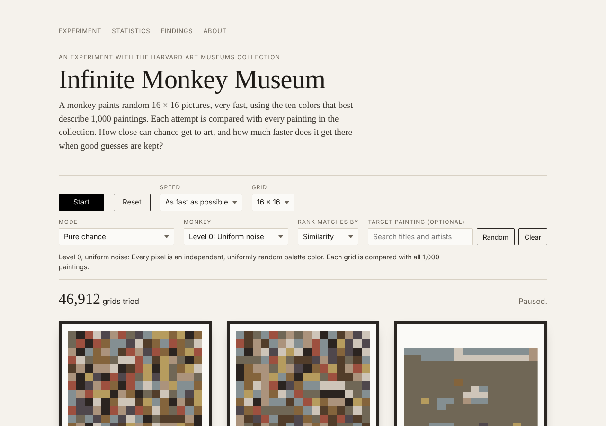
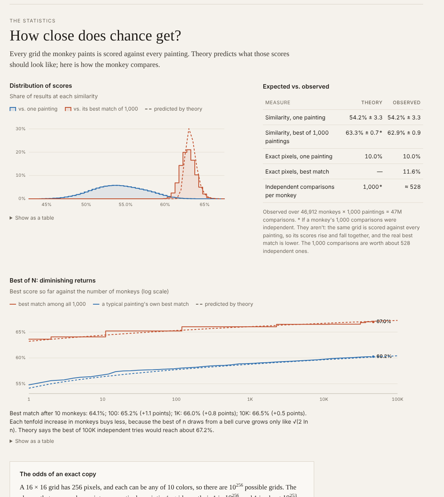
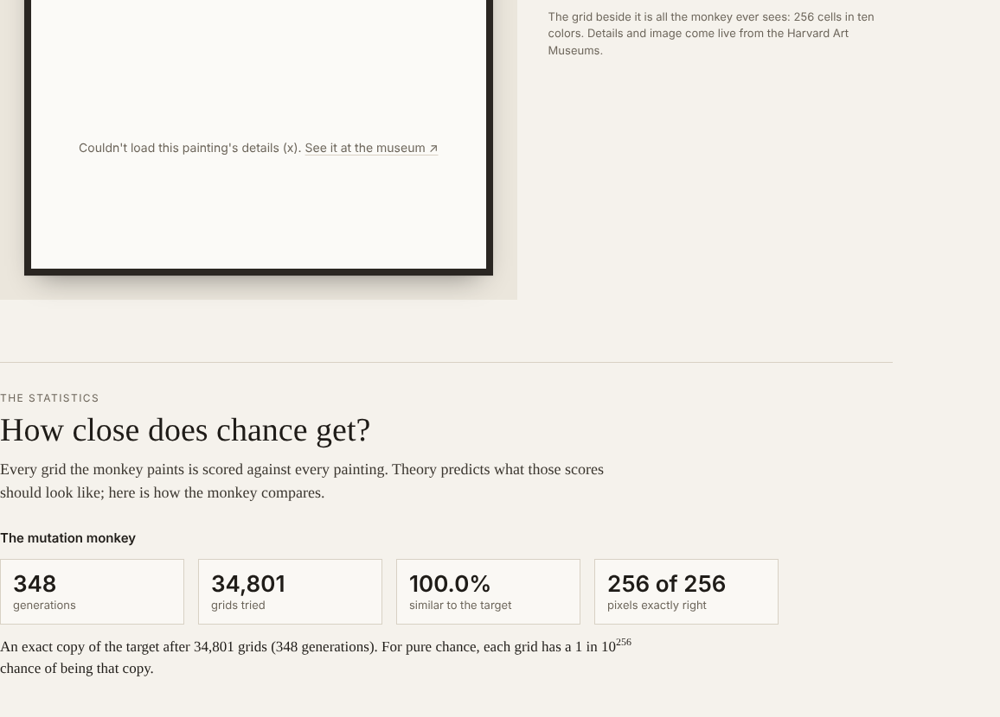

# Infinite Monkey Museum

**A monkey paints random pixel pictures, very fast, and compares every one
with tiny versions of real paintings from the Harvard Art Museums. How close
can chance get to art, and how much faster does it get there when good
guesses are kept?**

**Live site: LIVE_URL**



The site takes the *infinite monkey theorem* (a monkey typing at random will
eventually type Shakespeare) literally, and points it at a museum. Every
painting is reduced to a 16 × 16 grid in ten colors. A "monkey" running in
your browser paints thousands of random grids a second, scores each one
against all 1,000 paintings, and keeps statistics: how close the guesses get,
how that compares with what probability theory predicts, and how hopeless an
exact copy is. Smarter monkeys use shapes and real palettes, and a
*mutation monkey* (Richard Dawkins's "weasel") shows how cumulative selection
reaches in seconds what pure chance never will. A Findings section shows what
the collection looks like to the monkey: a museum of browns, and the bias
the method itself introduces.

---

## Contents

- [Using the site](#using-the-site)
- [How it works](#how-it-works)
  - [The data pipeline](#1-the-data-pipeline)
  - [Similarity](#2-similarity)
  - [The monkeys](#3-the-monkeys)
  - [The statistics](#4-the-statistics)
  - [Architecture](#5-architecture-and-why-the-key-is-behind-a-serverless-function)
- [Findings](#findings)
- [Background](#background)
- [Running it yourself](#running-it-yourself)
- [Project layout](#project-layout)
- [Credits](#credits)

## Using the site

| Control | What it does |
| --- | --- |
| **Start / Stop** (or the space bar) | Sets the monkey loose. It runs in a Web Worker, so the page stays smooth. |
| **Speed** | From 1 grid a second (watch every attempt) to as fast as possible (thousands a second). |
| **Grid** | 16 × 16 (256 cells) or 8 × 8 (64 cells), sharing one palette. |
| **Mode** | *Pure chance*: every grid is new. *Mutation*: keep the best grid, mutate it, repeat. |
| **Monkey** | Levels 0–3, from uniform noise to color fields in a real painting's palette (see below). |
| **Rank matches by** | *Similarity* (the raw score) or *Surprise* (how unusual that score is for that painting). |
| **Target painting** | Compare with one painting only (search by title or artist, or pick at random). The mutation monkey always has a target. |

The gallery shows the **latest attempt**, the **best grid so far** and the
**closest artwork**, drawn as its 16 × 16 grid in the painting's real
proportions. Below it, **the real painting** is fetched live from the museum
with its title, artist, culture, date, medium and dimensions, so the grid can
be compared with the painting itself.

The **Statistics** section updates live:

- a histogram of similarity scores, with the theory's prediction
- expected vs. observed means, spreads and exact-pixel rates
- a best-of-N curve on a log scale, which shows the diminishing returns of more monkeys
- the odds of an exact copy, in plain language and at the current speed



## How it works

### 1. The data pipeline

`scripts/build_grids.py` (Python, numpy and Pillow) builds `public/grids.json`
and `public/grids-8.json`:

1. **Fetch.** It asks the [Harvard Art Museums API](https://github.com/harvardartmuseums/api-docs)
   for every painting with an image the museum allows to be shown
   (`classification=Paintings`, `hasimage=1`, `imagepermissionlevel:0`),
   in the API's seeded random order (`sort=random:1874`), so a rerun gets
   the same sample. That's about 4,700 paintings, 100 per request.
2. **Download small.** It fetches each image at most 128 px on its long side
   from the museum's IIIF image service (`…/full/!128,128/0/default.jpg`),
   in parallel, with retries and a cache.
3. **Downsample.** It squeezes each image into a 16 × 16 grid by averaging
   (box filter). Nothing is cropped; each painting's aspect ratio is stored
   so the site can draw its grid in the right shape.
4. **One global palette.** It converts every pixel of every grid to CIE Lab
   (a color space where distance roughly matches perceived difference) and
   runs k-means with k = 10 (k-means++ initialization, 4 restarts). The 10
   cluster centers are the palette, sorted by how much of the collection
   each covers.
5. **Legibility filter.** Many paintings come out as one flat color at
   16 × 16, so the pipeline keeps only paintings that are still legible as a
   grid:
   - no palette color covers more than half the cells
   - at least 5 of the 10 colors appear
   - lightness varies (standard deviation of L\* ≥ 10)
   - the shape is no more than 3:2 tall or wide

   It keeps the first 1,000 such paintings in the random order. The palette
   depends on which paintings are kept and vice versa, so it refits and
   reselects until the selection stops changing (2–3 rounds). What the filter
   removed, by rule and by culture, is saved in the file.
6. **Quantize.** It maps each cell to the nearest palette color (Lab distance)
   and stores the 256 palette indices with id, title, artist, culture, date
   and aspect ratio. With `--size 16 8` it also writes the 8 × 8 version,
   with the same paintings and palette.

Run `python3 scripts/build_grids.py --help` for every option, including the
filter thresholds.

### 2. Similarity

Each grid cell holds one of the K = 10 palette colors. Let D(c, a) be the
Lab distance between palette colors c and a, and D<sub>max</sub> the largest
distance between any two palette colors. For a monkey grid *g* and a
painting *a* with n cells:

```
similarity = 1 − ( Σᵢ D(gᵢ, aᵢ) / n ) / D_max
```

So 1 means identical; 0 would mean every cell is the most different pair of
colors possible. The site also tracks the **exact-match %**, the share of
cells with exactly the right color (10% on average for random pixels).
Scoring one grid against 1,000 paintings is 256,000 table lookups, which the
worker does a few thousand times a second.

### 3. The monkeys

| Level | Name | How it paints |
| --- | --- | --- |
| 0 | Uniform noise | Every pixel independently and uniformly random. The textbook monkey. |
| 1 | Smudged | Pixels painted in reading order; each copies its left or upper neighbor 80% of the time, so colors form blobs. Every color is still equally likely in each cell. |
| 2 | Color fields | A ground color plus 2–6 random rectangles, like a sketch for a Rothko or a Mondrian. |
| 3 | Borrowed palette | Color fields painted with a real painting's colors in its proportions: the target's, or a random painting's for each grid. |

**The mutation monkey** (Dawkins's weasel) starts from one random grid. Each
generation it makes 100 copies with about one pixel changed at random, scores
them against the target, and keeps the best copy if it is at least as good
as the parent. The score never gets worse, and it stops at an exact copy.

### 4. The statistics

**Theory for independent pixels.** If each pixel is drawn independently
from a color distribution q (uniform at level 0), the similarity to painting
*w* is an average of n independent terms, so by the central limit theorem it
is close to a normal distribution with

```
m_a  = Σ_c q_c D(c, a)               mean distance to a cell of color a
v_a  = Σ_c q_c D(c, a)² − m_a²       its variance
μ_w  = 1 − (Σ_a f_wa m_a) / D_max    f_wa = share of painting w's cells with color a
σ_w  = √(Σ_a f_wa v_a / n) / D_max
```

The "one monkey vs. one painting" histogram is the mix of these 1,000
normal curves. The expected exact-match rate is Σ<sub>a</sub> f<sub>wa</sub> q<sub>a</sub>,
which is 1/K = 10% for uniform pixels.

**Best of N.** A monkey's best match is the maximum of 1,000 scores. *If*
those scores were independent, P(best ≤ x) = Π<sub>w</sub> Φ((x − μ<sub>w</sub>) / σ<sub>w</sub>).
They aren't: one grid is scored against every painting, so its scores rise
and fall together. The page shows the gap and turns it into an **effective
number of independent comparisons**: the N<sub>eff</sub> for which the best
of N<sub>eff</sub> independent scores has the observed average. The
**best-of-N curve** predicts the best score after n monkeys as the median of
the maximum, solving P(best ≤ x)<sup>n</sup> = ½. A typical painting's own
best is μ<sub>w</sub> + σ<sub>w</sub>·E[max of n standard normals], using
Blom's approximation.

**Surprise.** Flat, mid-toned paintings sit near the "center" of the palette,
so they score well against any noise, and raw similarity keeps picking the
same few. Ranking by *surprise*, z = (S − μ<sub>w</sub>) / σ<sub>w</sub>,
measures how unusual a score is for that painting. Under the theory every
painting's z is a standard normal curve, so every painting has the same
chance to be the match, and the best of N becomes the classic maximum of
normals.

**Odds.** An exact copy of one painting is 1 in K<sup>n</sup> = 10<sup>256</sup>
for 16 × 16. The page compares this with the ~10<sup>80</sup> atoms in the
observable universe, the expected wait at the current speed, and a universe
in which every atom is a monkey painting a billion grids a second since the
Big Bang. For mutation runs it uses the exact binomial tail: the chance that
a random grid gets at least k of 256 cells right.

The theory functions are unit-tested against simulated monkeys
(`test/stats.test.js`).

### 5. Architecture, and why the key is behind a serverless function

```
your computer (occasionally)              Vercel
──────────────────────────────            ─────────────────────────────────────────────
scripts/build_grids.py                    static site: public/
  key from .env (gitignored)  ─ commit ─▶   index.html, style.css, js/*, grids.json
  Harvard API + IIIF images                         │
                                                    ▼  in the browser
                                          js/worker.js   the monkey (Web Worker)
                                          js/app.js      gallery, stats, findings
                                                    │  /api/object?id=…
                                                    ▼
                                          api/object.js  (serverless function)
                                            adds HARVARD_API_KEY ──▶ Harvard Art Museums API
                                            returns public fields + image URL
```

- **The key never reaches the browser.** Anything in client-side JavaScript
  can be read by any visitor (View Source, developer tools). A leaked key
  could be used by anyone, use up the key's 2,500 requests a day, or get it
  revoked. The key lives only in Vercel's `HARVARD_API_KEY` environment
  variable and in a local, gitignored `.env`.
- **`api/object.js`** is the only code that runs on the server. It checks
  that `id` is a number, calls the museum's API with the key added, and
  returns only public fields (title, artist, culture, date, medium,
  dimensions, credit line, page link) plus an IIIF image URL that respects the
  museum's image permission level. Errors come back as clear messages that
  never contain the key. Responses are cached by Vercel's CDN for a day,
  so repeat views don't cost API calls.
- **The images themselves** load straight from the museum's public IIIF
  image server, which needs no key.
- **The pipeline runs on your own computer, and its output is committed.**
  It was first run during the Vercel build, but the museum's image server
  refuses downloads from cloud build machines (HTTP 403), even though the API
  works from there. The data is static anyway, so a committed `grids.json`
  makes deploys fast and reproducible. `scripts/vercel-build.sh` still runs
  the pipeline if `grids.json` is ever missing.
- **The monkey runs in a Web Worker,** so millions of comparisons a second
  never block scrolling or clicks. It sends the page about 12 updates a
  second.

## Findings

These numbers are from the current data (1,000 paintings, 16 × 16) and typical
runs in a browser. Live runs vary slightly.

**1. To a monkey, the museum is brown.** The ten-color palette is near-black
15%, dark brown 15%, taupe 13%, tan 12%, beige 12%, brown 9%, charcoal 9%,
blue-gray 6%, ochre 6% and brick red 4%. Browns, tans and ochres cover about
two-thirds of all pixels, and blacks, grays and off-whites most of the rest.
There is no blue or green at all. Averaged into big cells, skies, sea and
foliage melt into the surrounding browns and grays. Old varnish, which
yellows and darkens over time, and aged paper and silk push everything
warmer.

**2. The method has a point of view.** Of the 4,647 paintings with images,
only 1,262 (27%) are still legible at 16 × 16. The filter mostly removes East
Asian ink paintings: Chinese, Japanese and Korean paintings were 34% of the
paintings with images but are 7% of the collection here (Japanese 800 → 46,
Chinese 647 → 21, Korean 123 → 4). In those traditions, open ground
(*liubai*, "leaving white") is part of the composition. A pixel-similarity
measure reads it as one flat color, and without the filter, random noise
"matched" those near-blank scrolls almost every time. American paintings go
from 31% to 53% of the collection, and most kept paintings date from the
1800s and 1900s. The result is a Western, oil-on-canvas, nineteenth-century
museum. That reflects Harvard's collection, and the choice of metric, as
much as anything about chance.

**3. Theory predicts chance almost exactly, until comparisons interact.**
For level 0, the similarity of a random grid to a random painting is
predicted at 54.2% ± 3.3 and observed at 54.2% ± 3.3; exact pixels are
predicted and observed at 10.0%. The best of 1,000 paintings comes in below
the independent-comparison prediction (about 62.9% observed vs. 63.3%
predicted), because one grid is scored against all of them. The 1,000
comparisons are worth roughly 300–500 independent ones.

**4. Diminishing returns.** In a typical run the best match was 64.1% after
10 monkeys, 65.2% after 100 (+1.1 points), 66.0% after 1,000 (+0.8) and 66.5%
after 10,000 (+0.5). The maximum of n draws from a bell curve grows only like
√(2 ln n), so each tenfold increase buys less than the one before.

**5. Structure matters more than speed.** Every color is still equally likely
in each cell at levels 1 and 2, so the *average* similarity stays at about
54%. Neighboring cells move together, though, so the spread of scores widens
(±3.3 → ±5.2 → ±10.1), and the best of 1,000 paintings rises: 62.9% (noise),
66.5% (smudged), 77.2% (color fields), 81.0% (color fields in a real
palette). A little prior knowledge about what paintings look like is worth
more than any number of extra monkeys. That is the same lesson modern
generative models take to the extreme by learning those priors from data.

**6. Cumulative selection.** In six test runs, the mutation monkey made an
exact copy of its target in 32,000–39,500 grids (320–395 generations of
100). Pure chance would need about 10<sup>256</sup>.



## Background

**The infinite monkey theorem.** Émile Borel used typing monkeys in 1913 to
describe events so improbable they never happen. In *The Nature of the
Physical World* (1928) Arthur Eddington put them in a museum: *"If an army of
monkeys were strumming on typewriters they might write all the books in the
British Museum."* Jorge Luis Borges's *The Library of Babel* (1941) imagines
the library that holds every such book. This project asks the same question
of paintings, at thumbnail scale. Even 16 × 16 cells in ten colors give
10<sup>256</sup> possibilities, which makes "eventually" meaningless.

**Chance in art.** Artists have used chance on purpose for a century. Jean
Arp made *Collage with Squares Arranged according to the Laws of Chance*
(1916–17). Ellsworth Kelly let chance procedures place the colored squares
of *Spectrum Colors Arranged by Chance* (1951–53). Gerhard Richter's color
charts, such as *256 Farben* (1974), set out 256 colors in a grid in random
order: the same number of cells as the monkey's grids. Those works frame
chance as art. The monkey runs the opposite test: can chance land on art that
already exists?

**Dawkins's weasel.** In *The Blind Watchmaker* (1986) Richard Dawkins
contrasted single-step selection, where random letters must spell *METHINKS
IT IS LIKE A WEASEL* all at once, with cumulative selection, where the best
of each generation of copies breeds the next and reaches the phrase in a few
dozen generations. The Mutation mode does the same with a painting. Like
Dawkins's program it knows its target, which evolution does not; the
comparison is about how fast keeping partial successes compounds, not a model
of evolution.

**Extreme value statistics.** The best of many random tries follows its own
laws (Fisher and Tippett, 1928; Gnedenko, 1943; Gumbel, 1958). For bell-curve
scores the maximum of n grows like √(2 ln n): slowly, and ever more slowly.
That is the shape of the best-of-N curve. The gap between the independent
prediction and the observed best is a reminder that a thousand correlated
comparisons are not a thousand chances.

**How the collection shapes the findings.**

- **Region.** The Harvard Art Museums (the Fogg, Busch-Reisinger and Arthur M.
  Sackler museums) hold large American, European and Asian collections. The
  paintings with images are about a third East Asian, which the legibility
  filter mostly removes.
- **Era.** The kept paintings are mostly from the 1800s and 1900s.
- **Palette.** Oil paint, varnish and aged supports make the collection's
  average color brown. A different museum, a different metric (one that
  rewards empty space, say) or a different grid size would give a different
  monkey a different museum.

## Running it yourself

You need a free Harvard Art Museums API key: request one at
<https://harvardartmuseums.org/collections/api>.

**Build the data** (only needed to change the collection; the built files are
committed):

```bash
cp .env.example .env
```

Put your key after `HARVARD_API_KEY=` in `.env` (it's gitignored), then:

```bash
python3 -m venv .venv && .venv/bin/pip install -r scripts/requirements.txt
```

```bash
.venv/bin/python scripts/build_grids.py --size 16 8
```

This takes a few minutes the first time (about 4,700 small images, cached in
`.cache/` afterwards). Commit `public/grids.json` and `public/grids-8.json`.

**Run the site locally.** The site is plain static files, plus one function
for the real-painting panel. With the [Vercel CLI](https://vercel.com/docs/cli):

```bash
vercel dev
```

Any static server works too (for example `python3 -m http.server -d public`).
Without the function, the real-painting panel shows a message and a link to
the museum instead.

**Deploy to Vercel.**

1. Import the GitHub repository in Vercel (Application Preset: *Other*;
   `vercel.json` sets the build command and the `public` output folder).
2. Under **Settings → Environment Variables**, add `HARVARD_API_KEY` for
   Production and Preview. Don't prefix it with `NEXT_PUBLIC_` or anything
   similar; it must stay on the server.
3. Push to `main`. Vercel builds and deploys it. If you change an environment
   variable later, redeploy.

**Tests.**

```bash
npm test
```

This runs 47 tests: the theory against simulated monkeys, the monkey levels
and the weasel, the API proxy with a mocked museum API (including that the
key never appears in a response), the Findings helpers, and the pipeline's
color math, k-means, legibility filter and downloader (with a fake API, no
network needed).

## Project layout

```
api/object.js             serverless proxy: object id -> public details + image URL (key on the server)
scripts/build_grids.py    data pipeline: fetch, download, downsample, filter, palette, quantize
scripts/vercel-build.sh   Vercel build step (uses the committed grids; rebuilds only if missing)
scripts/test_build_grids.py
public/index.html         the page
public/style.css          the museum look
public/grids.json         1,000 paintings as 16 x 16 palette indices + palette + selection report
public/grids-8.json       the same paintings at 8 x 8
public/js/core.js         Lab colors, similarity scoring, monkey levels, the weasel step
public/js/stats.js        theory (per-painting normal model, best of N, surprise), tallies, odds
public/js/worker.js       the monkey loop (Web Worker)
public/js/app.js          controls, gallery, wiring
public/js/statsview.js    the statistics section
public/js/charts.js       SVG histogram and best-of-N charts (hover readouts, table views)
public/js/reveal.js       the real painting, via /api/object
public/js/findings.js     palette names, legibility by culture, eras
test/                     JS tests (node --test)
docs/                     screenshots for this README
```

There's no framework and no build step for the site: plain HTML, CSS and
JavaScript modules.

## Credits

- Artwork data and images: [Harvard Art Museums API](https://github.com/harvardartmuseums/api-docs).
  Images © President and Fellows of Harvard College or the rights holders
  credited with each work; used here for study. This project isn't affiliated
  with the Harvard Art Museums.
- Made for a course on applying generative AI software to the arts and
  natural sciences, after a visit to the Harvard Art Museums. The code was
  written with Claude Code, an AI coding assistant, directed and reviewed by
  the author.
